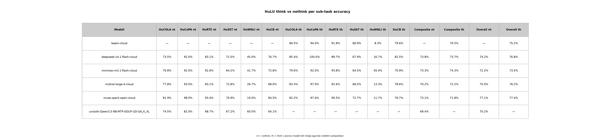
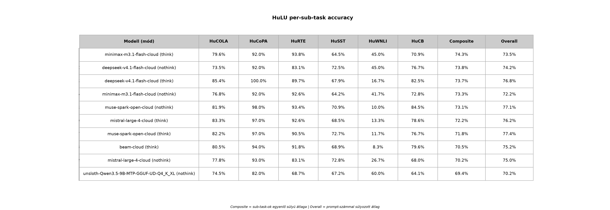

# HuLU Per-Sub-Task Bontás

*Generálva:* 2026-11-09T20:04:43.850478+00:00

*10 benchmark (egyedi rekord: utolsó előfordulás alapján).*

## Táblázat — think vs nothink (accuracy %, külön oszlopok)

| Modell | HuCOLA nt | HuCoPA nt | HuRTE nt | HuSST nt | HuWNLI nt | HuCB nt | HuCOLA th | HuCoPA th | HuRTE th | HuSST th | HuWNLI th | HuCB th | Composite nt | Composite th | Overall nt | Overall th |
|---|---|---|---|---|---|---|---|---|---|---|---|---|---|---|---|---|
| **beam-cloud** | — | — | — | — | — | — | 80.5% | 94.0% | 91.8% | 68.9% | 8.3% | 79.6% | — | 70.5% | — | 75.2% |
| **deepseek-v4.1-flash-cloud** | 73.5% | 92.0% | 83.1% | 72.5% | 45.0% | 76.7% | 85.4% | 100.0% | 89.7% | 67.9% | 16.7% | 82.5% | 73.8% | 73.7% | 74.2% | 76.8% |
| **minimax-m3.1-flash-cloud** | 76.8% | 92.0% | 92.6% | 64.2% | 41.7% | 72.8% | 79.6% | 92.0% | 93.8% | 64.5% | 45.0% | 70.9% | 73.3% | 74.3% | 72.2% | 73.5% |
| **mistral-large-4-cloud** | 77.8% | 93.0% | 83.1% | 72.8% | 26.7% | 68.0% | 83.3% | 97.0% | 92.6% | 68.5% | 13.3% | 78.6% | 70.2% | 72.2% | 75.0% | 76.2% |
| **muse-spark-open-cloud** | 81.9% | 98.0% | 93.4% | 70.9% | 10.0% | 84.5% | 82.2% | 97.0% | 90.5% | 72.7% | 11.7% | 76.7% | 73.1% | 71.8% | 77.1% | 77.4% |
| **unsloth-Qwen3.5-9B-MTP-GGUF-UD-Q4_K_XL** | 74.5% | 82.0% | 68.7% | 67.2% | 60.0% | 64.1% | — | — | — | — | — | — | 69.4% | — | 70.2% | — |

## Táblázat — per sub-task (accuracy %)

| Modell (mód) | HuCOLA | HuCoPA | HuRTE | HuSST | HuWNLI | HuCB | Composite | Overall |
|---|---|---|---|---|---|---|---|---|
| **minimax-m3.1-flash-cloud (think)** | 79.6% (n=910) | 92.0% (n=100) | 93.8% (n=243) | 64.5% (n=1165) | 45.0% (n=60) | 70.9% (n=103) | **74.3%** | 73.5% |
| **deepseek-v4.1-flash-cloud (nothink)** | 73.5% (n=910) | 92.0% (n=100) | 83.1% (n=243) | 72.5% (n=1165) | 45.0% (n=60) | 76.7% (n=103) | **73.8%** | 74.2% |
| **deepseek-v4.1-flash-cloud (think)** | 85.4% (n=910) | 100.0% (n=100) | 89.7% (n=243) | 67.9% (n=1165) | 16.7% (n=60) | 82.5% (n=103) | **73.7%** | 76.8% |
| **minimax-m3.1-flash-cloud (nothink)** | 76.8% (n=910) | 92.0% (n=100) | 92.6% (n=243) | 64.2% (n=1165) | 41.7% (n=60) | 72.8% (n=103) | **73.3%** | 72.2% |
| **muse-spark-open-cloud (nothink)** | 81.9% (n=910) | 98.0% (n=100) | 93.4% (n=243) | 70.9% (n=1165) | 10.0% (n=60) | 84.5% (n=103) | **73.1%** | 77.1% |
| **mistral-large-4-cloud (think)** | 83.3% (n=910) | 97.0% (n=100) | 92.6% (n=243) | 68.5% (n=1165) | 13.3% (n=60) | 78.6% (n=103) | **72.2%** | 76.2% |
| **muse-spark-open-cloud (think)** | 82.2% (n=910) | 97.0% (n=100) | 90.5% (n=243) | 72.7% (n=1165) | 11.7% (n=60) | 76.7% (n=103) | **71.8%** | 77.4% |
| **beam-cloud (think)** | 80.5% (n=910) | 94.0% (n=100) | 91.8% (n=243) | 68.9% (n=1165) | 8.3% (n=60) | 79.6% (n=103) | **70.5%** | 75.2% |
| **mistral-large-4-cloud (nothink)** | 77.8% (n=910) | 93.0% (n=100) | 83.1% (n=243) | 72.8% (n=1165) | 26.7% (n=60) | 68.0% (n=103) | **70.2%** | 75.0% |
| **unsloth-Qwen3.5-9B-MTP-GGUF-UD-Q4_K_XL (nothink)** | 74.5% (n=910) | 82.0% (n=100) | 68.7% (n=243) | 67.2% (n=1165) | 60.0% (n=60) | 64.1% (n=103) | **69.4%** | 70.2% |