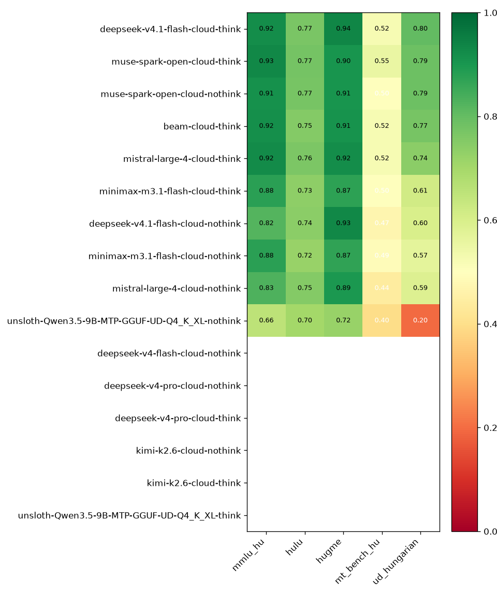

# Modell Értékelési Riport

*Generálva:* 2026-11-09T22:39:54.043367+00:00

## Composite Score (súlyok: stat=0.4, gen=0.4, ling=0.2)

| Modell | mmlu_hu | hulu | hugme | mt_bench_hu | ud_hungarian | Composite |
|---|---|---|---|---|---|---|
| **deepseek-v4.1-flash-cloud-think** | 0.921 | 0.767 | 0.937 | 0.521 | 0.804 | **0.790** |
| **muse-spark-open-cloud-think** | 0.931 | 0.774 | 0.903 | 0.552 | 0.788 | **0.790** |
| **muse-spark-open-cloud-nothink** | 0.914 | 0.771 | 0.905 | 0.500 | 0.785 | **0.775** |
| **beam-cloud-think** | 0.916 | 0.752 | 0.909 | 0.521 | 0.772 | **0.774** |
| **mistral-large-4-cloud-think** | 0.924 | 0.762 | 0.919 | 0.521 | 0.740 | **0.773** |
| **minimax-m3.1-flash-cloud-think** | 0.879 | 0.735 | 0.873 | 0.500 | 0.614 | **0.720** |
| **deepseek-v4.1-flash-cloud-nothink** | 0.823 | 0.742 | 0.930 | 0.469 | 0.598 | **0.712** |
| **minimax-m3.1-flash-cloud-nothink** | 0.876 | 0.722 | 0.869 | 0.490 | 0.569 | **0.705** |
| **mistral-large-4-cloud-nothink** | 0.831 | 0.750 | 0.895 | 0.438 | 0.586 | **0.700** |
| **unsloth-Qwen3.5-9B-MTP-GGUF-UD-Q4_K_XL-nothink** | 0.655 | 0.702 | 0.720 | 0.396 | 0.199 | **0.535** |
| **deepseek-v4-flash-cloud-nothink** | — | — | — | — | — | — |
| **deepseek-v4-pro-cloud-nothink** | — | — | — | — | — | — |
| **deepseek-v4-pro-cloud-think** | — | — | — | — | — | — |
| **kimi-k2.6-cloud-nothink** | — | — | — | — | — | — |
| **kimi-k2.6-cloud-think** | — | — | — | — | — | — |
| **unsloth-Qwen3.5-9B-MTP-GGUF-UD-Q4_K_XL-think** | — | — | — | — | — | — |

## Heatmap

