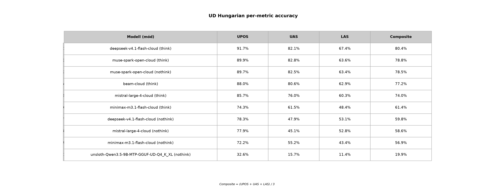

# UD Hungarian Per-Metric Bontás

*Generálva:* 2026-11-09T22:40:04.484900+00:00

*10 benchmark (egyedi rekord: utolsó előfordulás alapján).*

Composite = (UPOS + UAS + LAS) / 3.

## Táblázat — per metric (accuracy %)

| Modell (mód) | UPOS | UAS | LAS | Composite |
|---|---|---|---|---|
| **deepseek-v4.1-flash-cloud (think)** | 91.7% (n=449) | 82.1% (n=449) | 67.4% (n=449) | **80.4%** |
| **muse-spark-open-cloud (think)** | 89.9% (n=449) | 82.8% (n=449) | 63.6% (n=449) | **78.8%** |
| **muse-spark-open-cloud (nothink)** | 89.7% (n=449) | 82.5% (n=449) | 63.4% (n=449) | **78.5%** |
| **beam-cloud (think)** | 88.0% (n=449) | 80.6% (n=449) | 62.9% (n=449) | **77.2%** |
| **mistral-large-4-cloud (think)** | 85.7% (n=449) | 76.0% (n=449) | 60.3% (n=449) | **74.0%** |
| **minimax-m3.1-flash-cloud (think)** | 74.3% (n=449) | 61.5% (n=449) | 48.4% (n=449) | **61.4%** |
| **deepseek-v4.1-flash-cloud (nothink)** | 78.3% (n=449) | 47.9% (n=449) | 53.1% (n=449) | **59.8%** |
| **mistral-large-4-cloud (nothink)** | 77.9% (n=449) | 45.1% (n=449) | 52.8% (n=449) | **58.6%** |
| **minimax-m3.1-flash-cloud (nothink)** | 72.2% (n=449) | 55.2% (n=449) | 43.4% (n=449) | **56.9%** |
| **unsloth-Qwen3.5-9B-MTP-GGUF-UD-Q4_K_XL (nothink)** | 32.6% (n=449) | 15.7% (n=449) | 11.4% (n=449) | **19.9%** |